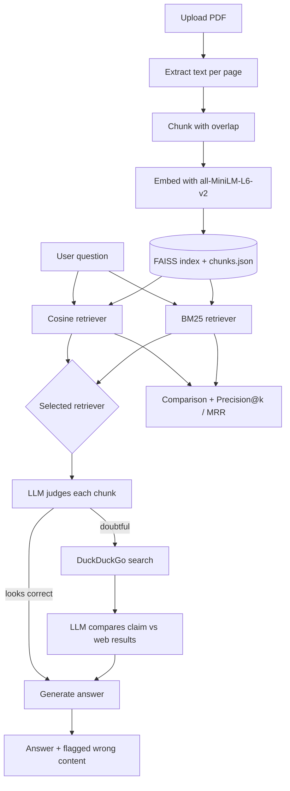

# FactCheck RAG PDF Chatbot

A Streamlit chatbot that answers questions about your PDFs using Retrieval-Augmented Generation (RAG) and **fact-checks the retrieved content against the internet**. If a passage in the document looks wrong, the agent verifies it with a web search and tells you that the document's claim is incorrect, with the evidence and sources.

Everything runs locally except the web search: the LLM is served by [Ollama](https://ollama.com), embeddings come from a sentence-transformers model, and the vector index lives on your disk.

## Features

- **PDF ingestion**: upload one or more PDFs, which are chunked (with overlap) and embedded automatically.
- **Local embeddings**: `all-MiniLM-L6-v2` (384-dimensional) from sentence-transformers.
- **FAISS + JSON storage**: vectors are stored in a FAISS index, and chunk text and metadata (source file, page, id) are stored in a readable `chunks.json`. Both are saved to disk and reloaded on startup.
- **Two retrievers, side by side**: cosine similarity (semantic) and BM25 (keyword), both implemented from scratch with the formulas in the code. You choose which one feeds the LLM.
- **Retrieval accuracy demo**: tick the chunks that really answer your question and the app computes **Precision@k** and **MRR** for both retrievers.
- **Agentic fact-checking**: a local LLM judges each retrieved chunk. Only doubtful claims trigger a DuckDuckGo search, and the LLM then compares the claim with the results (`contradicted`, `supported` or `inconclusive`).
- **Local LLM**: runs on Ollama (default `llama3.2:3b`), so no API key is needed.

## How it works



1. **Ingestion**: `pypdf` extracts the text page by page. A sliding-window chunker (default 1000 characters, 200 overlap, snapped to sentence ends) splits it. Chunks are embedded and stored in FAISS, and the chunk text goes to `data/chunks.json`.
2. **Retrieval**: the question is retrieved with both cosine similarity and BM25. The retriever chosen in the sidebar supplies the context for the LLM.
3. **Fact-check agent**: for each retrieved chunk, the LLM answers from its own knowledge as `correct` or `doubtful`. For doubtful chunks it extracts the suspect claim, searches DuckDuckGo, and compares the claim with the results.
4. **Answer**: the LLM answers from the context. If a claim was contradicted by the web, the answer states that the document appears to be wrong, gives the correct information, and cites the sources.

## Project structure

```
.
├── app.py                 # Streamlit frontend
├── config.py              # constants and paths
├── document_processor.py  # PDF extraction + chunking
├── embeddings.py          # all-MiniLM-L6-v2 embeddings
├── vector_store.py        # FAISS index + JSON persistence
├── cosine_retriever.py    # dense retrieval (cosine similarity)
├── bm25_retriever.py      # sparse retrieval (BM25, with stopword removal)
├── evaluation.py          # Precision@k, MRR, overlap
├── llm.py                 # Ollama calls: judge, compare, answer
├── fact_checker.py        # DuckDuckGo search + agent loop
├── benchmark.py           # times each indexing stage
├── requirements.txt
└── data/                  # created on first upload
    ├── faiss.index
    └── chunks.json
```

## Getting started

### Prerequisites

- Python 3.10 or newer
- [Ollama](https://ollama.com/download) installed and running

### Installation

```bash
git clone https://github.com/<your-username>/<repo-name>.git
cd <repo-name>

python -m venv venv
# Windows:  venv\Scripts\activate
# macOS/Linux:  source venv/bin/activate

pip install -r requirements.txt

ollama pull llama3.2:3b
```

### Run

```bash
streamlit run app.py
```

Open the URL Streamlit prints (usually http://localhost:8501), upload a PDF in the sidebar, and start asking questions.

## Usage tips

- **Compare retrievers**: ask one question that reuses the document's exact wording (BM25 usually does well) and one paraphrased question (cosine usually does better). Tick the relevant chunks to see Precision@k and MRR for each.
- **Try the fact-checker**: upload a document containing a deliberately wrong fact (for example, a wrong date or a wrong capital city), then ask about it.
- **Change the model**: type any model you have pulled into the "Ollama model" box in the sidebar, for example `llama3.1:8b` or `qwen2.5:7b`. Larger models judge claims more reliably.
- **Fresh start**: delete the `data/` folder to clear the saved index.

## Configuration

Defaults live in `config.py`:

| Setting | Default | Meaning |
|---|---|---|
| `EMBED_MODEL_NAME` | `all-MiniLM-L6-v2` | embedding model |
| `DEFAULT_LLM` | `llama3.2:3b` | Ollama model name |
| `DEFAULT_CHUNK_SIZE` / `DEFAULT_CHUNK_OVERLAP` | 1000 / 200 | characters |
| `DEFAULT_TOP_K` | 4 | chunks retrieved per question |
| `BM25_K1` / `BM25_B` | 1.5 / 0.75 | BM25 parameters |
| `BM25_REMOVE_STOPWORDS` | `True` | drop common words before BM25 scoring |
| `WEB_MAX_RESULTS` | 5 | DuckDuckGo results used for verification |

Chunk size, overlap, top-k, model, retriever and the fact-check toggle can also be changed from the sidebar.

## Limitations

- **Small-model accuracy**: a 3B model sometimes flags correct text as doubtful or misses a real error. The web step reduces false alarms, because a claim is reported as wrong only when the search results contradict it. It is not a guarantee.
- **Search snippets only**: verification uses DuckDuckGo result snippets, not full web pages, so some claims end up `inconclusive`.
- **Scanned PDFs**: PDFs that are only images have no extractable text, and OCR is not included.
- **In-memory FAISS flat index**: this suits documents of up to a few thousand chunks. It is not built for very large collections.
- **Rate limits**: DuckDuckGo may throttle repeated searches.
- **Not a source of truth**: treat the fact-check verdicts as a helpful signal and check important claims yourself.

## Troubleshooting

**A wall of `ModuleNotFoundError: No module named 'torchvision'` warnings in the terminal.**
This is Streamlit's file watcher trying to scan every `transformers` module. It is harmless, but you can silence it:

```bash
streamlit run app.py --server.fileWatcherType none
```

**Indexing takes very long.**
Run `python benchmark.py your.pdf` to see how long each stage takes (imports, model load, text extraction, chunking, embedding). The first run also downloads the embedding model (about 90 MB).

**`Could not reach Ollama model ...`**
Make sure Ollama is running and the model is pulled (`ollama list`).

## Roadmap ideas

- Hybrid retrieval that combines BM25 and cosine rankings
- OCR support for scanned PDFs
- Claim extraction before searching, so each claim is verified separately
- Fetching full web pages instead of snippets for verification

## License

Add your license here (for example, MIT).
